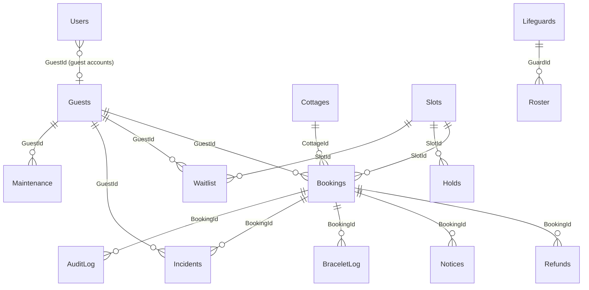

# Database guide

## Files

| File | Purpose |
|---|---|
| `database/Tampisaw.SqlServer.sql` | Idempotent script: all tables, indexes and EF migration history, including `20261024090000_RootAdminAndAccountSecurity` (safe to re-run). |
| `database/02_Tampisaw_Queries.sql` | Views and ready-to-run queries for availability, conflicts, bookings, payments, accounts, reports. |

The script mirrors the application's EF Core migrations. The latest one was written by hand (it could not be executed where this
version was prepared), so run the app once against a copy of your database and check the log before using it on production data.
It adds `Users.Archived/CreatedAt/CreatedBy`, `AuditLog.Role`, `Holds.EventStart/GuestId` and **drops `Users.FaceImage`**
(selfies are no longer collected; the stored photos are deleted by this change). A second migration, `20261025090000_BookingArchiveAndPaymentOption`, adds `Bookings.Archived/ArchivedAt/ArchivedBy/PaymentOption`.

## How the application uses the database

* On start-up it loads all data from SQL Server.
* Every change (booking, payment, cancellation, admin edit) is checked by the server, applied under a lock, and written
  back in **one transaction**. If a write fails the change is retried on the next save and the health endpoint
  (`/api/health`) reports the error.
* Because the app keeps the working copy in memory: **read** with SSMS whenever you like, but **stop the app before editing
  rows by hand**, then restart it.
* Passwords are stored only as salted PBKDF2 hashes (`Users.PasswordHash`).

## Tables (27)

Bookings, Guests, Users, Cottages, Slots, Holds, Blackouts, Policies, Addons, Settings, Tariff, OpsConfig, Draft,
Staff, Lifeguards, Roster, ShiftReports, PoolLogs, Waitlist, Incidents, Maintenance, Notices, Refunds, BraceletLog,
SyncQueue, ScanHistory, AuditLog.

## Logical relationships

### Important: foreign keys

The columns above are indexed, and **the server enforces these relationships** (a booking must reference an existing
cottage and the signed-in guest; guests can only act on their own bookings; refunds/notices are created only through a
booking). However, **the SQL Server tables do not have `FOREIGN KEY` constraints yet.**
Reason: the application writes whole changes as one batch through Entity Framework and some rules intentionally leave
rows behind (for example, deleting a guest account keeps its *paid* bookings anonymised for accounting). Adding hard
constraints safely needs the relationships declared in the EF model plus a migration, and that must be tested against a
real SQL Server, which was not available while this version was prepared. Constraints added by hand today could make
saves fail.

## Provider

Microsoft SQL Server is the only provider. Put the connection string in user-secrets or `ConnectionStrings__Tampisaw`.
